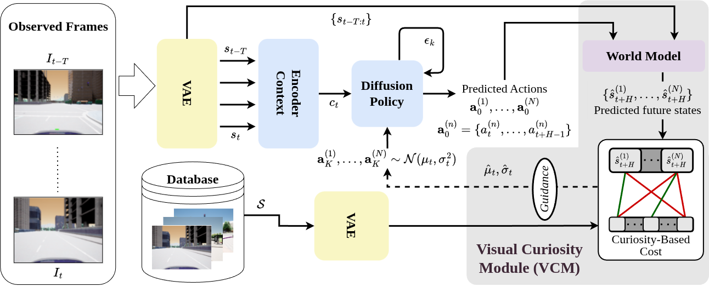

# Vanderer

Vanderer is a visual exploration method for robots. It guides a diffusion navigation policy using a world model that predicts future states.



## Setup

The code uses two conda environments: `vanderer` for the models and `vanderer-carla` for everything that talks to CARLA.

1. Create the model environment and install the code:
    ```bash
    conda env create -f environment.yml
    conda activate vanderer
    pip install --no-deps -e third_party/diffusion_policy --config-settings editable_mode=compat
    pip install --no-deps -e .
    ```

2. Install [CARLA 0.9.15](https://github.com/carla-simulator/carla/releases/tag/0.9.15), then create the CARLA environment:
    ```bash
    export CARLA_ROOT=/path/to/carla_0.9.15
    export CARLA_BIN=$CARLA_ROOT/CarlaUE4/Binaries/Linux/CarlaUE4-Linux-Shipping
    conda env create -f environment_carla.yml
    conda activate vanderer-carla
    pip install $CARLA_ROOT/PythonAPI/carla/dist/carla-0.9.15-cp37-cp37m-manylinux_2_27_x86_64.whl
    ```
    Keep both variables set when you run anything in `carla_client/`.

## Weights and data

Place weights and datasets in these folders:

```
checkpoints/
  policy/
  world_model/
data/
  <dataset_name>/
```

## Evaluation

To evaluate on one town:

```bash
cd carla_client
./run_experiment.sh --method vanderer --town 1 --seed 1
```

To run a batch of towns and seeds, skipping runs that already exist:

```bash
cd carla_client
METHODS="vanderer" TOWNS="1 2 3 4 5" SEEDS="1 2 3" ./batch_run.sh
```

To compute the road exploration metrics, run this from `carla_client/` in the CARLA environment:

```bash
python -m evaluation.road_exploration_metrics --out ../outputs/metrics/road_metrics.csv
```

## Data format

```
<dataset_name>/
  <trajectory>/
    0.jpg, 1.jpg, ...
    traj_data.pkl    # dict: "position" [T, 2], "yaw" [T,]
```

Each dataset needs an entry in `train/vint_train/data/data_config.yaml`, where `metric_waypoint_spacing` is the average distance between consecutive frames in metres:

```yaml
<dataset_name>:
  metric_waypoint_spacing: <metres>
```

To create the train and test splits:

```bash
python train/data_split.py --data-dir data/<dataset_name> --dataset-name <dataset_name>
```

For [TartanGround](https://tartanair.org/tartanground/), run these instead to convert the downloaded data to this format and create its splits:

```bash
python preprocess/preprocess_tartanground.py --raw-root data/tartan_ground --out-root data/tartan_ground_processed
python preprocess/data_split_tartanground.py --raw-root data/tartan_ground
```

## Training

Once your data is in the format above, encode the images to prepare for training. Run this from the repo root once for each split:

```bash
python train/preprocess_embeddings.py --data_dir data/<dataset_name> \
  --dataset_name <dataset_name> --enc_checkpoint stabilityai/sd-vae-ft-ema \
  --split <split> --image_size 224 224 --batch_size 128 --num_workers 16
```

Run the policy training commands from `train/`. Outputs go to `train/logs/`. To pretrain on TartanGround:

```bash
cd train
torchrun --nproc_per_node=<num_gpus> train.py -c config/naviexp_vae.yaml
```

To fine-tune on your dataset, copy `config/naviexp_vae.yaml` to `config/my_finetune.yaml` and change these settings. `load_run` is relative to `train/logs/`.

```yaml
run_name: finetune_vae
load_run: forward_model/<pretrained_run>
finetune: True
datasets:
  <dataset_name>:
    data_folder: ${data_root}/<dataset_name>
    train: ${data_splits}/<dataset_name>/train/
    test: ${data_splits}/<dataset_name>/test/
    end_slack: 1
    goals_per_obs: 1
    negative_mining: False
```

Then run:

```bash
torchrun --nproc_per_node=<num_gpus> train.py -c config/my_finetune.yaml
```

To fine-tune the world model, list your data under `datasets` in `third_party/nwm/config/nwm_cdit_b_finetune.yaml`, add it to `third_party/nwm/config/data_config.yaml`, and run this from the repo root:

```bash
torchrun --nproc_per_node=1 -m nwm.train --config third_party/nwm/config/nwm_cdit_b_finetune.yaml
```

## License

This repository is mixed-license:

- `third_party/nwm/` is under CC BY-NC 4.0, so it's for non-commercial use only. See its [LICENSE](third_party/nwm/LICENSE.md) and [NOTICE](third_party/nwm/NOTICE.md).
- `third_party/diffusion_policy/` keeps its own license.
- `carla_client/envs/carla/agents/` is a modified copy of CARLA's agents package, under [its MIT license](carla_client/envs/carla/agents/LICENSE.carla).
- Everything else is under the MIT license in [LICENSE](LICENSE).
